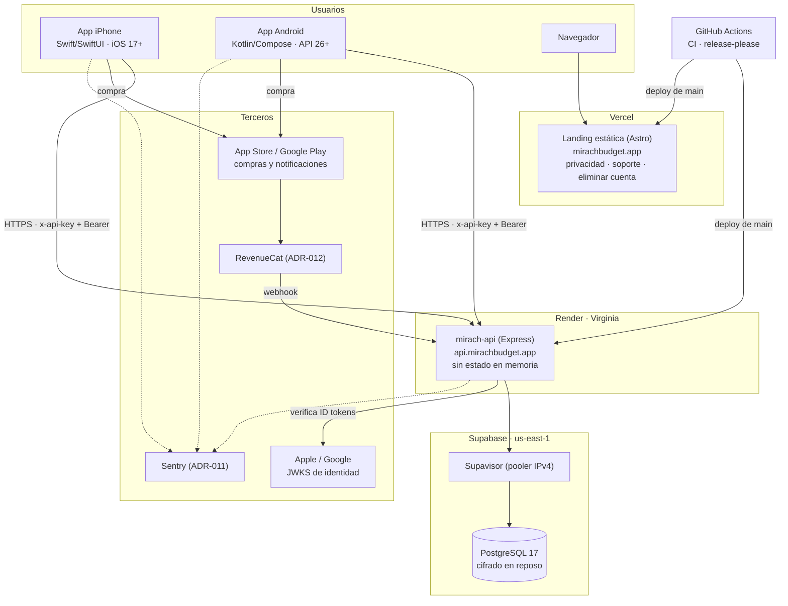

# ADR-002 — Topología de despliegue y ambientes

## Estado

Aceptado (2026-10-25); propuesto el 2026-10-24. La topología actual está desplegada (**vigente**). El dominio
propio del API es **nuevo**. Decisión del product owner (2026-10-24): **seguir en los
planes gratis por ahora**, como riesgo aceptado, con los gatillos de la sección 6 para
pasar a plan pagado y crear staging.

## Contexto

- La v1 se publica en App Store y Google Play para usuarios de todo Chile. La web es solo
  una landing.
- La infraestructura de Mirach es propia, sin nada compartido con MoneyDiary: base Supabase
  `mirach` en `us-east-1`, servicio Render `mirach-api` en Virginia, landing en Vercel bajo
  `mirachbudget.app`.
- El servicio de Render está en el plan gratis: se duerme tras 15 minutos sin tráfico y la
  primera petición demora hasta ~1 minuto. Las apps esperan 90 segundos y ofrecen
  "Reintentar". Eso es aceptable para pruebas, no para un usuario de nivel tecnológico bajo
  que abre la app por primera vez.
- Render despliega `main` automáticamente y no corre migraciones; hoy se aplican a mano.
- El plan gratis de Supabase no incluye respaldos diarios y pausa proyectos inactivos.
  Al redactar este ADR (2026-10-24) el proyecto `mirach` figura como **inactivo (pausado)**
  en Supabase: el API de producción no tiene base hasta reactivarlo.

## Decisión

### 1. Topología

| Pieza | Dónde | Plan hoy | Cuando se active un gatillo (sección 6) |
|-------|-------|----------|-------------------------------|
| API | Render, web service, Virginia | Gratis | Starter o superior: siempre encendido, deploy sin corte, comando previo al deploy para migraciones |
| Base de datos | Supabase `us-east-1`, vía pooler | Gratis | Pro: respaldos diarios, sin pausa por inactividad |
| Landing | Vercel | Hobby | Revisar: el plan Hobby no permite uso comercial; pasar a Pro o a un hosting estático alternativo |
| Apps | App Store, Google Play | TestFlight y prueba cerrada | Producción con lanzamiento escalonado |
| CI | GitHub Actions | Gratis (repo privado con minutos limitados; iOS usa runners macOS) | Vigilar el consumo de minutos de macOS |

Costo de referencia del cambio de plan, cuando ocurra: ~USD 7/mes (Render Starter) + ~USD 25/mes
(Supabase Pro), más USD 99/año de Apple Developer y USD 25 únicos de Google Play. Los
precios son de referencia y hay que confirmarlos al contratar.

### 2. Dominio propio para el API (nuevo)

Las apps llaman a `https://api.mirachbudget.app`, no a `mirach-api.onrender.com`. Una app
instalada no se puede actualizar a voluntad: con dominio propio, cambiar de proveedor o de
región no exige publicar una versión nueva.

### 3. Ambientes

| Ambiente | Para qué | Base de datos | Estado |
|----------|----------|---------------|--------|
| Desarrollo | Trabajo local | PostgreSQL en Docker (`pnpm api db:up`) | Vigente |
| Test | CI: integración, e2e y DAST | PostgreSQL efímero en un contenedor de servicio | Vigente |
| Staging | Probar migraciones y builds de TestFlight o prueba cerrada antes de producción | Proyecto Supabase aparte, solo datos sintéticos | Diferido; se crea con los gatillos de la sección 6 |
| Producción | Usuarios reales | Supabase `mirach` | Vigente |

`NODE_ENV` (`development`, `test`, `production`) es la fuente única del ambiente lógico.
La configuración se valida con Zod al arrancar: el proceso no arranca si falta una variable
o si una combinación es insegura (por ejemplo `ALLOW_DESTRUCTIVE_DB` en producción).
Staging corre con `NODE_ENV=production` y variables propias.

### 4. Región y residencia de datos

API y base de datos quedan juntas en el este de EE. UU. Render no ofrece región en
Sudamérica, y separar el API de la base agregaría latencia en cada consulta. La latencia
desde Chile (~130 ms por viaje) cabe en los objetivos de RNF-PER-002.

Los datos personales se almacenan fuera de Chile. La política de privacidad debe declararlo,
y la transferencia internacional debe ampararse en lo que exija la Ley 21.719 (por ejemplo,
cláusulas contractuales con Supabase y Render). Este punto requiere revisión legal antes del
1 de diciembre de 2026.

### 5. Continuidad

| Indicador | Objetivo con plan pagado | Cómo |
|-----------|-------------|------|
| RPO (datos que se pueden perder) | 24 horas | Respaldo diario de Supabase Pro |
| RTO (tiempo para volver) | 4 horas | Restaurar respaldo, redeploy en Render |
| Llave de cifrado | Nunca se pierde | `ENCRYPTION_KEY` respaldada fuera de Render, en un gestor de contraseñas; sin ella los campos cifrados son irrecuperables |

Una restauración se prueba al menos una vez antes del lanzamiento y luego cada seis meses.

### 6. Plan gratis como riesgo aceptado y gatillos

Mientras dure el plan gratis:

- Supabase pausa el proyecto tras una semana sin actividad. Antes de cada prueba con
  usuarios o revisión de tienda se verifica que esté activo, y se reactiva si hace falta.
- La cuenta de revisión de App Store y Google Play necesita un API que responda: se avisa
  del arranque en frío en las notas para el revisor.
- Sin respaldos diarios, el RPO real es el último volcado manual. Se hace un `pg_dump`
  cifrado antes de cada migración y cada semana mientras haya usuarios de prueba.

Se pasa a Render Starter y Supabase Pro, y se crea staging, cuando ocurra lo primero de:

| Gatillo |
|---------|
| La app pasa de prueba cerrada a producción en cualquiera de las dos tiendas |
| Hay usuarios fuera del grupo de prueba con datos reales |
| Se cobra la primera suscripción |
| El proyecto de Supabase se pausa con usuarios activos |

## Alternativas consideradas

| Alternativa | Por qué no |
|-------------|------------|
| Nube grande con infraestructura como código (AWS, GCP + Terraform) | Costo de operación (red, IAM, parches) incompatible con un solo desarrollador; ningún requisito lo exige. Revisar si una exigencia de residencia de datos obliga a infraestructura en Chile. |
| Contenedores en Fly.io, Railway o Cloud Run | Portabilidad que hoy no se necesita; Render ya resuelve build, TLS y deploy. Revisar si Render encarece mucho o si se necesita una región en Sudamérica. |
| Pasar a plan pagado desde ya | Elegida para después: hoy no hay usuarios fuera del grupo de prueba que justifiquen el costo fijo. |
| Sin staging | Hoy las migraciones se aplican a mano contra producción; con usuarios reales, un error de esquema no tiene dónde ensayarse. |

## Consecuencias

- Mientras siga el plan gratis, el arranque en frío, la pausa de Supabase y la falta de respaldos son riesgos aceptados. Al activarse un gatillo, el costo fijo sube a ~USD 32/mes.
- Con el plan pagado, `prisma migrate deploy` corre como comando previo al deploy y deja de
  ser un paso manual; las migraciones siguen el patrón expandir y contraer (ADR-004).
- El API no guarda estado en memoria (sesiones en la base): se puede pasar a varias
  instancias sin cambiar código (ADR-003).
- Hay dependencia moderada de Render, Supabase y Vercel. Mitigación: el API es Node estándar
  y la base es PostgreSQL estándar; migrar cuesta trabajo, pero no reescritura.

## Referencias

- ADR-003 Mantenibilidad y escalabilidad
- ADR-004 Persistencia
- ADR-008 CI/CD
- ADR-009 Seguridad
- `render.yaml`, `apps/landing/vercel.json`
- Serie anterior: ADR-004, ADR-023, ADR-029, ADR-046
