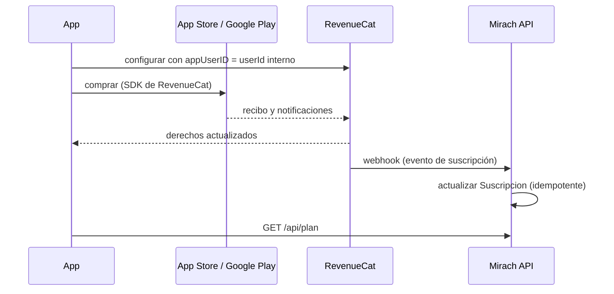

# ADR-012 — Suscripciones y derechos por plan

## Estado

Propuesto (2026-10-24). Decisión del product owner (2026-10-24): **RevenueCat** como capa
de suscripciones (**nuevo**). No hay nada construido todavía. Decisión del product owner
(2026-10-25): los planes y el cobro entran en la **v1.1**; en la v1.0 Plus es gratis para
todos durante el lanzamiento, y se avisa desde el inicio que Plus será pago.

## Contexto

- La monetización es una suscripción con plan gratis limitado y prueba de 30 días del plan
  Plus, con precio mensual y anual (PLA-01 a PLA-03).
- App Store y Google Play exigen su propio sistema de cobro para suscripciones digitales.
- El plan debe valer en iPhone y Android con la misma cuenta (PLA-06), restaurarse al
  cambiar de teléfono (PLA-05) y no borrar datos al vencer (PLA-07).
- Implementar las dos tiendas directamente exige StoreKit 2, App Store Server API y sus
  notificaciones, Play Billing, Play Developer API y notificaciones en tiempo real por
  Pub/Sub de Google Cloud, más los casos borde de cada una (períodos de gracia, reembolsos,
  cambios de plan).

## Decisión

### 1. RevenueCat entre las tiendas y el API

- Las apps usan el SDK de RevenueCat para mostrar ofertas, comprar y restaurar.
- El `appUserID` es el id interno del usuario (un `cuid`), nunca el email.
- El API recibe los eventos en `POST /api/webhooks/revenuecat`, autenticado con un secreto
  en el encabezado `Authorization`, y los procesa una sola vez por id de evento.
- La tabla `Suscripcion` guarda plan, estado (`prueba`, `activa`, `en_gracia`, `cancelada`,
  `vencida`), vencimiento, tienda y último evento procesado (ADR-004).

### 2. El API decide los derechos

- La fuente de verdad para autorizar es la tabla `Suscripcion` del API, no el estado que
  informa la app (ADR-006).
- Si falta un evento o hay duda, el API consulta la API REST de RevenueCat para reconciliar,
  y un trabajo diario reconcilia las suscripciones que vencen ese día.
- Los límites de cada plan viven en la configuración del API y se exponen en
  `GET /api/config` (PLA-08). Los precios viven en las tiendas.

### 3. Prueba de 30 días

- Se configura como oferta introductoria gratis de 30 días en ambas tiendas. Cada tienda
  aplica su regla de una prueba por cuenta de tienda.
- El aviso "Tu prueba Plus termina en 3 días" (PLA-09) se calcula en el API con el
  vencimiento guardado y se muestra dentro de la app.
- Al terminar sin compra, la cuenta pasa al plan gratis sin perder datos (PLA-07).

### 4. Eventos

Cada cambio de suscripción emite el evento de dominio `SuscripcionCambiada`, que registra
`plan_cambiado` para los KPIs de conversión (ADR-011). Es el único flujo externo dirigido
por eventos de la v1 (ADR-001).

### 5. Experimentos de precio

El A/B de precios dentro de la app (PLA-08) puede usar las ofertas de RevenueCat. Algunas
funciones de experimentos son de planes pagos de RevenueCat; mientras tanto, la prueba de
precio se hace en la landing con el botón de puerta falsa (LAN-04).

## Alternativas consideradas

| Alternativa | Por qué no |
|-------------|------------|
| Integración propia con ambas tiendas | Semanas de trabajo en recibos, notificaciones y casos borde de dos tiendas, más un proyecto de Google Cloud para Pub/Sub. Se revisa si la comisión de RevenueCat pesa en el margen o si se quiere internalizar. |
| Adapty o Qonversion | Funcionalidad parecida; RevenueCat tiene más documentación y comunidad para Swift y Kotlin. |
| Cobro directo por web | Las tiendas lo restringen para contenido digital consumido en la app; fuera de la v1. |
| Postergar los planes por completo | El modelo de negocio es una hipótesis que hay que validar con cobro real. Se posterga solo el cobro: la v1.0 sale con Plus gratis y el cobro entra en la v1.1 (2026-10-25), para medir retención antes de cobrar y no sumar las compras dentro de la app a la salida a producción. |

## Consecuencias

- Costo: RevenueCat es gratis hasta un umbral de ingreso mensual y luego cobra un
  porcentaje (confirmar el precio vigente al contratar), además de la comisión de las
  tiendas.
- RevenueCat recibe el historial de compras y el id interno: se declara en la política de
  privacidad y en las fichas de las tiendas, con su acuerdo de tratamiento de datos.
- Si RevenueCat no está disponible, los derechos ya guardados siguen valiendo; solo se
  retrasan compras nuevas.
- Se necesita cuenta de Apple Developer y productos configurados en ambas tiendas antes de
  probar compras (PUB-01, PUB-05).

## Referencias

- ADR-001, ADR-004, ADR-005, ADR-006, ADR-011
- Documentación de RevenueCat: webhooks, REST API, SDK de iOS y Android
- Serie anterior: no hay
