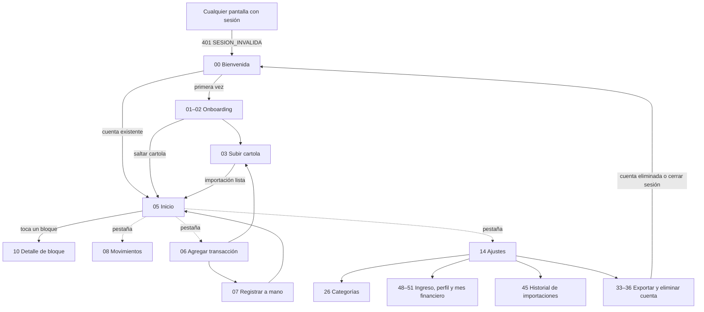

# Catálogo de pantallas

Especificación de comportamiento de las apps nativas de Mirach (iPhone y Android), organizada por flujo. Cada archivo de `flujos/` lista sus pantallas con el nodo de Figma y los requisitos que cumplen, y describe solo lo que Figma no expresa: endpoints, cuerpos, códigos de error, estados y navegación. Ambas apps siguen este catálogo para no divergir.

**Qué vive en otra parte.** Este catálogo no repite reglas de producto ni diseño visual:

- Qué debe hacer el producto y por qué: [`docs/requisitos`](../requisitos/README.md). Las pantallas citan los requisitos por ID (`IMP-05`, `CLA-14`).
- Cómo se ve cada pantalla: Figma, archivo [Mirach-UI](https://www.figma.com/design/NY2IRzO5C4z6Y4NTfuAG2u/Mirach-UI?node-id=2-3), página *Diseño*. El mapa de pantallas es el nodo [`156:1630`](https://www.figma.com/design/NY2IRzO5C4z6Y4NTfuAG2u/Mirach-UI?node-id=156-1630). Colores, tipografía y espaciado salen de las variables de Figma vía `design/tokens.json`.
- Contrato HTTP: [`apps/api/openapi.json`](../../apps/api/openapi.json). Cada endpoint nombrado aquí existe en ese archivo; lo que una pantalla necesita y el contrato no ofrece se lista en [Brechas del API](#brechas-del-api), con su issue.
- Decisiones técnicas: [`docs/adr`](../adr/README.md). Toda regla de negocio o cálculo vive en el API (ADR-001).

**Cómo se usa.** Un cambio en una pantalla empieza en su archivo de flujo (o copiando [`_plantilla.md`](flujos/_plantilla.md) para un flujo nuevo) y después se implementa en cada app. Un cambio de producto empieza en `docs/requisitos`; aquí solo se actualiza la referencia.

## Flujos

| Flujo | Archivo | Alcance |
|---|---|---|
| Primer uso: bienvenida, inicio de sesión y onboarding | [`flujos/primer-uso.md`](flujos/primer-uso.md) | v1.0 |
| Subir una cartola | [`flujos/subir-cartola.md`](flujos/subir-cartola.md) | v1.0 |
| Registrar a mano | [`flujos/registro-a-mano.md`](flujos/registro-a-mano.md) | v1.0 |
| Inicio y movimientos | [`flujos/inicio-y-movimientos.md`](flujos/inicio-y-movimientos.md) | v1.0 |
| Categorías y patrones | [`flujos/categorias-y-patrones.md`](flujos/categorias-y-patrones.md) | v1.0 |
| Ingreso, perfil y mes financiero | [`flujos/ingreso-perfil-y-mes.md`](flujos/ingreso-perfil-y-mes.md) | v1.0 |
| Importaciones, privacidad y cuenta | [`flujos/importaciones-y-cuenta.md`](flujos/importaciones-y-cuenta.md) | v1.0 |
| Plan y suscripción | [`flujos/planes.md`](flujos/planes.md) | v1.1 (decisión D1) |

## Mapa de navegación (v1.0)

La barra inferior de Figma tiene cinco elementos: Inicio, Movimientos, «+ Agregar transacción», Historial y Ajustes. **Historial (pantalla 13, VIS-13 y VIS-08) queda fuera de la v1.0** (decisiones D3 y D6), así que la v1.0 muestra cuatro: Inicio, Movimientos, «+» y Ajustes. Categorías se abre desde Ajustes.

## Reglas globales

**Autenticación y encabezados.**

- Toda llamada a `/api` lleva el encabezado `x-api-key` (compuerta pública del cliente, ADR-006).
- Toda llamada, salvo `GET /api/auth/capabilities`, `POST /api/auth/apple/token` y `POST /api/auth/google/token`, lleva además `Authorization: Bearer <token>`. El token y su `expiresAt` salen de `AuthLoginResponse` (`token`, `userId`, `expiresAt`).
- El token se guarda en el almacenamiento seguro del sistema (Keychain en iPhone, cifrado con el Android Keystore en Android) y se descarta al cerrar sesión, al recibir 401 `SESION_INVALIDA` y al eliminar la cuenta.
- Al iniciar la app con un token guardado se valida con `GET /api/auth/me`: 200 entra al Inicio, 401 vuelve a la bienvenida.

**Sesión vencida.** Un 401 con `code` `SESION_INVALIDA` en cualquier llamada autenticada descarta la sesión y lleva a la bienvenida, sin reintento automático. Un 401 con `code` `API_KEY_INVALIDA` es un error de la app (clave de cliente incorrecta), no de la persona: se muestra un error genérico y no se borra la sesión.

**Errores.** Los cuerpos de error son `{ message, code? }`. Orden de preferencia para el texto mostrado: copia propia de la app para el `code` conocido; si no, el `message` del servidor cuando el flujo lo indica; si no, un texto genérico. Un fallo de red se muestra como «Problema de conexión» con reintento. Los 5xx son transitorios y ofrecen reintento; los 4xx de validación no se reintentan sin que la persona cambie algo.

**Patrones de estado.** Toda pantalla que carga datos tiene cuatro estados: *Cargando* (sin datos viejos de otro mes o cuenta), *Vacío* (explica por qué y ofrece la acción que lo resuelve), *Error con reintento* y *Éxito*. Las acciones de escritura anuncian su resultado en una región de estado accesible. Tirar para refrescar repite la consulta de lectura.

**Dinero.** Los montos del API son cadenas decimales enteras en pesos chilenos (`"1234567"`, a veces con `-`). Se parsean como enteros exactos, nunca como `Float` ni `Double` (RNF-EXA-001), y se muestran como `$1.234.567` (`-$1.234` para negativos). El signo `+`/`-` solo se antepone donde el flujo lo indica. Cifras y fechas con dígitos tabulares (RNF-USA-006).

**Porcentajes.** `porcentajeBp` y `metaBp` están en puntos base: se muestran como `porcentajeBp / 100` con `%` y coma decimal local (`3050` es `30,5%`). `null` (mes sin ingreso) se muestra «—». La app solo da formato; no calcula porcentajes propios (RNF-EXA-002).

**Fechas y períodos.** `fecha` llega como marca ISO-8601 UTC; se muestra la fecha de calendario de sus primeros diez caracteres, sin convertir a la zona del dispositivo. Un período es `AAAA-MM`. Cuando se omite `periodo`, el API resuelve el último mes con movimientos y lo devuelve: la pantalla muestra el valor devuelto, no el pedido.

**Terminología.** Los bloques se muestran como **Necesidades, Gustos y Ahorro**. El API todavía nombra `Deseos` al bloque de Gustos (valor de enumeración y algunos textos del servidor, brecha 5): la app traduce `Deseos` → «Gustos» en toda la interfaz y nunca muestra «Deseos».

**Estados de un bloque.** Bien, Cerca o Sobre, siempre con color, marca cuadrada y texto (VIS-02, regla 9). El estado del mes es el peor de los tres bloques (VIS-11). El cálculo lo hace el API (#113).

**Confirmación de acciones destructivas.** Eliminar una importación, una categoría, un patrón, un movimiento manual o la cuenta pide confirmación explícita con la consecuencia descrita. Descartar una revisión de cartola también.

**Accesibilidad.** Objetivos táctiles de al menos 44 pt (iPhone) y 48 dp (Android); cada control con nombre accesible; los cambios de estado relevantes se anuncian (VoiceOver y TalkBack). El texto respeta el tamaño de fuente del sistema (RNF-ACC-002).

## Fuera del catálogo

| Función | Motivo |
|---|---|
| Correo y contraseña (`POST /api/auth/login`, `PATCH /api/perfil/password`) | Solo Apple y Google (ADR-006). El login con contraseña existe únicamente para la cuenta de revisión de las tiendas. |
| Cambio de correo y vincular o desvincular Google (`PATCH /api/perfil` con `email`, `/api/perfil/google/*`) | El correo llega del proveedor y no se edita (PER-09). |
| Modo demo | Se eliminó del producto. |
| Flujo web de Google y sesión por cookie | Piezas web dormidas (ADR-005); los clientes nativos usan token. |
| Subida de un solo paso (`POST /api/ingestas`) | Obsoleta; se usa `preview` + `commit`. |
| Listado plano (`GET /api/movimientos`, `GET /api/buckets/{bucket}`) | Las pantallas usan `GET /api/buckets/{bucket}/detalle` y `GET /api/ingresos/mes`. |
| Historial anual y comparación con el mes anterior (pantalla 13) | VIS-13 y VIS-08 fuera de la v1.0 (D3, D6). |
| Selector de tema claro u oscuro | VIS-16 fuera de la v1.0 (D3); la v1.0 sigue el tema del sistema. |
| Búsqueda por texto | MOV-06 fuera de la v1.0 (D3). |
| Tipos de patrón «empieza con» y «expresión regular», y prioridad de patrones | CLA-14 y CLA-12 (D5); ver #129 y #130. |

## Brechas del API

Lo que las pantallas necesitan y el contrato o el servidor aún no ofrecen. Ninguna se resuelve con lógica en el cliente.

| # | Brecha | Flujo | Issue |
|---|---|---|---|
| 5 | Textos del servidor con «Deseos» (`semaforo-detalle.ts`, `catalogo-incompleto.error.ts`). La app usa copia propia. | Subir cartola (409), Inicio | #113 |
| 7 | Mensajes del servidor con voseo o jerga (por ejemplo `CONFIRMACION_INVALIDA`, `BUCKET_NO_ASIGNABLE`). La app usa copia propia para esos `code`. | Categorías, Cuenta | — |
| 9 | Orden de las listas sin documentar: `GET /api/ingestas` entrega la más reciente primero y `GET /api/categorias` ordena por nombre. | Importaciones, Categorías | — |
| 10 | Estados Bien, Cerca y Sobre, estado del mes y el bloque que lo define (hoy el API entrega el semáforo heredado `verde`/`amarillo`/`rojo`). | Inicio | #113 |
| 11 | Perfil de presupuesto, metas del resumen según el perfil, ingreso declarado y día de inicio del mes. | Primer uso, Ingreso y perfil, Inicio | #110, #111 |
| 12 | Consentimientos versionados (términos al crear la cuenta, permiso para procesar cartolas). | Primer uso, Subir cartola | #112 |
| 13 | Rechazo de estados de cuenta de tarjeta con código propio. | Subir cartola | #115 |
| 14 | Confirmación de traspasos propios, devoluciones y sobregiros. | Subir cartola, Movimientos | #142 |
| 15 | Datos del Inicio sin campo en el contrato: «Datos hasta el …» (VIS-04), frase del mes (VIS-03, VIS-17), lo que queda «sin gastar» y la cantidad de movimientos en Desconocido (MOV-05). | Inicio | #136 (por desglosar en el API) |
| 16 | Vista previa de un patrón y «aplicar a parecidos»: con cuántos movimientos coincide y moverlos sin tocar los reclasificados a mano (CLA-03, CLA-15, CLA-16). `POST /api/transacciones/reevaluar` no sirve: reevalúa todos los movimientos y sobrescribe también los cambiados a mano. | Categorías, Movimientos | #140 |
| 17 | Exportar los datos en Excel o CSV (PRI-04). | Cuenta | #144 |
| 18 | Cerrar sesión en todos los dispositivos (AUTH-06). | Cuenta | #146 |
| 19 | Configuración remota y versión mínima por plataforma (`GET /api/config`). | Todos | #116 |
| 20 | Coincidencia de patrones sin distinguir tildes y desempate por largo (CLA-12, CLA-14). | Categorías, Subir cartola | #129 |
| 21 | El 400 de `POST /api/movimientos` responde solo `{message}`, sin `code`; los motivos (`FECHA_FUTURA`, `MONTO_INVALIDO`…) existen en el dominio pero no salen en la respuesta. | Registrar a mano | #138 (por desglosar en el API) |
| 22 | Marcar un movimiento como ignorado: no cuenta en los porcentajes pero sigue visible (MOV-04). No hay soporte en el API. | Movimientos | #139 (por desglosar en el API) |
| 23 | La allowlist de íconos del API (25 valores, `icono-categoria.ts`) no coincide con el set de 24 íconos de CLA-11 (decidido el 23-10-2026): CLA-11 pide Bolsa, Paquete, Taza, Libro y Flechas, que el API no tiene, y el API tiene `fuel`, `wifi`, `graduation-cap`, `shield`, `bike` y `gamepad-2`, que CLA-11 no lista. | Categorías | — |

Cerradas: 1 (códigos de la subida documentados en `openapi.json`), 2 (`403 CATEGORIA_INTERNA`), 3 (`esInterna` en `CategoriaResponse`), 4 (el gráfico del Inicio usa `porcentajeBp` frente a la meta, sin un «% del gasto» propio), 6 (revocación de Sign in with Apple al eliminar la cuenta) y 8 (el 401 distingue `API_KEY_INVALIDA` de `SESION_INVALIDA`).
